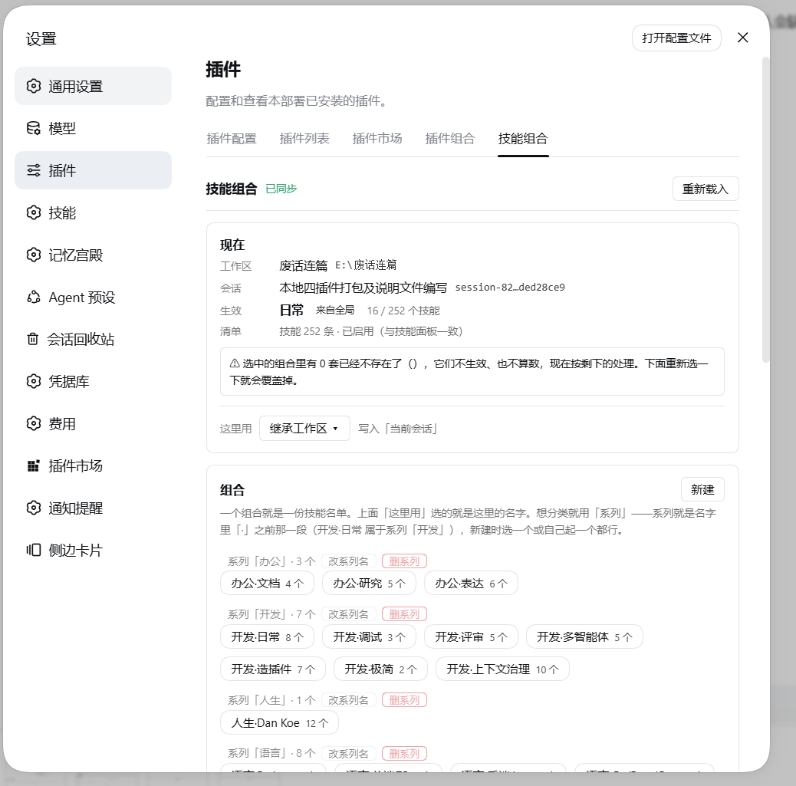
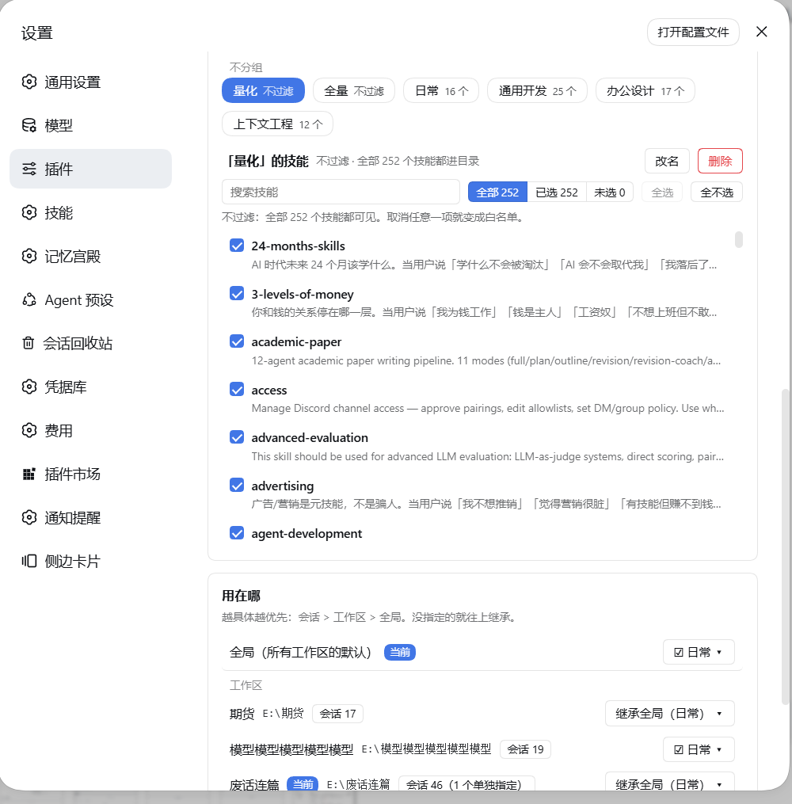

# dsh-capability-composer

**The resident tool surface collapses into a few switchable sets, shrinking the system prompt on demand.**

> ⚠️ **DSH 1.5 only** (`>=0.1.5-rc.2 <0.2.0`). Newer DSH releases will be supported in follow-up updates.

**English** · [简体中文](README.zh-CN.md)

[](LICENSE)
[](#compatibility)
[](#compatibility)

**Shrink what the model sees, not what is running.**

---

## Table of contents

- [What this is](#what-this-is)
- [What it does (four mechanisms)](#what-it-does-four-mechanisms)
- [How a composition is resolved (three levels)](#how-a-composition-is-resolved-three-levels)
- [UI](#ui)
- [Screenshots](#screenshots)
- [Configuration](#configuration)
- [HTTP API](#http-api)
- [🔗 Integration](#-integration)
- [Known limitations (stated plainly)](#known-limitations-stated-plainly)
- [Installation](#installation)
- [Compatibility](#compatibility)
- [FAQ](#faq)
- [Repository layout](#repository-layout)
- [Self-check](#self-check)
- [License](#license)

---

## What this is

By default DSH stuffs all of the following **into every single request**:

| What gets stuffed in | Measured size |
|---|---|
| **Tool schema** registered by every installed plugin | 414 tool definitions / ~65.6K tokens |
| The **catalog of all skills** | ~76K tokens as a baseline |
| The **system-prompt section** registered by each plugin | `agent-teams:usage` ≈1296 tok + `plugin:dsh-docker` ≈579 tok + `plugin:api-client` ≈254 tok |

Every request pays for "the things you might use", while only a few of them are actually useful in this turn.

`dsh-capability-composer` groups these into **compositions**, and **only lets the current composition into the context**.

### What it does / what it does not do

Let's make the boundary clear first, because this is where misunderstandings happen most easily:

| ✅ It does | ❌ It does not |
|---|---|
| Narrow **the plugin catalog the model sees** | Never turns off any plugin — plugin processes keep running, the UI keeps showing them |
| Shadow **skill catalog entries** that are not on the list | Never removes skills — `/skill-name` can still be invoked manually |
| Make tools **non-resident by default** (keeping only the core + meta tools) | Does not restrict execution — `invoke_tool` can call anything by default |
| Prune the **system-prompt sections** registered by plugins, according to the composition | Does not touch committed history |
| Resolve compositions at the session / workspace / global levels | Does not modify any third-party plugin file on disk |

In one sentence: **it shrinks "the catalog the model can see", not "the things that are running".** Plugins keep running, skills stay available, tools stay callable — all that changes is how much gets stuffed into each request.

---

## What it does (four mechanisms)

### ① Tools are non-resident by default

**Only 31 are resident**: the 28 official core tools, plus 3 meta tools — `search_plugins` / `load_plugin` / `invoke_tool`.

All other tools **never enter the tools list**. The model sees them in the catalog section of the system prompt (section heading `# 可用插件与 MCP 工具`), and calls them directly when needed:

```js
invoke_tool({ tool: "mcp__vnpy__run_backtest", args: { ... } })
```

Use `load_plugin` when a whole group needs to be loaded:

```js
load_plugin({ ids: ["mcp:vnpy"] })
```

**The granularity is "plugin", not "tool name".** This is deliberate: finer granularity was tried — after 417 / 211 tool names were compressed away, the model had no idea what to search for, which made things harder to use instead. The granularity now is the plugin.

Mounting it prints one log line saying so:

```
工具按需加载已挂载：常驻白名单 28 个 + 元工具 3 个（其余全部按需；组合只决定可见范围）
```

### ② Skill shadowing (not disabling)

A skill that is not in the current skill composition gets a **shadow entry with the same name** registered:

- `invocation.modelInvocable: false` — does not enter the skill catalog the model can see and auto-invoke
- `rank: 0` — the lowest rank wins, shadowing the original skill

**`/skill-name` can still be invoked manually.**

One shadow entry is mounted at the global level, and every agent gets one more at the **"nearest level"**, so that session-level compositions also take effect at the agent dimension.

### ③ Plugin compositions narrow "the model's plugin catalog"

Narrowing happens **when the catalog section is generated**, not by unloading plugins.

There are **two lines that are never narrowed**:

- **MCP server lines** — one line per MCP server; the tools inside a server are not governed by compositions
- **The "unassigned tools" fallback line** — tools that cannot be attributed to any plugin are always kept

### ④ System-prompt sections registered by plugins are pruned by composition too

Plugin compositions **cannot control** "the system-prompt sections a plugin registers for itself" — those are inserted by the plugin itself in `system-prompt/assemble`, and are a different thing from the catalog section.

This plugin's `prunePluginSections()` is the only place that can prune them according to the current plugin composition.

Measured saving: **≈2129 tokens / request**:

| Section | Size |
|---|---|
| `agent-teams:usage` | ≈1296 tok |
| `plugin:dsh-docker` | ≈579 tok |
| `plugin:api-client` | ≈254 tok |

**Fail-open design** — better to prune too little than to prune by mistake:

- A section whose owner cannot be identified is always kept
- A section without a namespace is always kept
- When the visible plugin list is empty, **nothing is pruned**, and the log records 「没有『不在组合里』的依据，宁可留着」
- When the plugin list cannot be obtained, nothing is pruned either

Every drop prints one line of evidence to the log.

It can be turned off with `DSH_COMPOSER_PRUNE_PLUGIN_SECTIONS=0`.

---

## How a composition is resolved (three levels)

**The rule is "the nearest level that specifies something wins" — not a strict override.**

| Level | Description |
|---|---|
| 1. **Session** | specified for the current session alone |
| 2. **Workspace** | specified for the current working directory (`cwd`) |
| 3. **Global** | `pinned[axis]['*']` |

A few easy-to-get-wrong points:

- **An empty string / an empty array / `null` all count as "not specified"** and keep inheriting from the level above — they do not mean "specified as empty"
- **A single level can select several entries**; the union is taken
- **An empty list = no filtering** (not "select none"). To select none, use `__none__`

The UI shows which level the current one comes from: 『当前会话』 / 『当前工作区』 / 『全局』 (Session / Workspace / Global).

---

## UI

It installs into DSH's **Settings → Plugins**, adding two tabs:

### Plugin compositions

Decides which plugins appear in **the model's plugin catalog**.

### Skill compositions

Decides which skills appear in **the model's skill catalog**. You can create a composition, rename it, delete it (with a second confirmation), rename a series, delete a series, select all / select none, and search skills.

### Changes take effect immediately, no restart needed

- UI changes are **debounced by 400 ms**, then `POST /dsh-capability-composer/state`
- After the host writes to disk, the state is refreshed immediately

### Saving merges item by item per composition name, not a whole-state overwrite

The server state is the base; only composition names that **actually exist** in the local draft are overwritten. So a composition created elsewhere will not be accidentally deleted by this UI.

The trade-off: a composition deleted here will be "resurrected" if it still exists on the server. **This is a deliberately conservative direction** — losing a composition costs far more than keeping one extra composition.

---

## Screenshots

### Skill compositions page

Manage which skills each composition contains under Settings → Plugins → Skill compositions, and which level 「这里用」 ("Use here") applies to.



### Skill scope

Organize skill compositions by series, and use the dropdown to pick which set the current session / current workspace / global each use.



---

## 9. Official patches: this plugin needs none

This plugin only occupies `system-prompt/assemble` and the skills service, so it **needs no official DSH patches** and shows no patch dialog — that notice belongs to the two plugins that do need patches (`dsh-context-reclaim`, `dsh-aux-degrade`).

To see what the ten official patches do and whether you want them:

- the tutorial "Install & official patches" → `tutorial-install-and-official-patches.md` (shipped inside this plugin);
- the patch library → <https://github.com/xiamubumu/dsh-patch-library> (ten self-contained patches, an adaptive applier, five ways to apply them, ready-made prompts).

## Configuration

### State file

**There is exactly one**:

```
<DSH_HOME>/capability-composer/compositions.json
```

The resolution order for `<DSH_HOME>`:

| Platform | Path |
|---|---|
| All | `DSH_HOME` environment variable (takes priority) |
| Windows | `%APPDATA%\dsh-desktop\harness` |
| macOS | `~/Library/Application Support/dsh-desktop/harness` |
| Linux | `$XDG_CONFIG_HOME/dsh-desktop/harness` or `~/.config/dsh-desktop/harness` |

**If none of them exists, it errors out and exits — it never guesses a hard-coded path and silently writes into it.**

A `compositions.json.bak` backup is made automatically before every write.

Two other runtime files (both are caches; delete them and they are rebuilt automatically):

| File | Purpose |
|---|---|
| `capability-composer/entry-id-map.json` | cache from package name → entry id |
| `.composer-resident-tools` | the auto section of the resident tool list |

### First install starts empty

A fresh machine gets `defaultState()` — four empty slots, no compositions, no pins. **No seed and no
"starter pack" is shipped**: every composition in such a file would be somebody else's, and a new
user opening the composer must not find arrangements they never created.

**Your existing `compositions.json` is never overwritten and never cleared** — an empty state is
written only when the file is absent or unreadable.

### Environment variables

**This plugin has no cordis config; everything is tuned through environment variables.**

| Variable | Default | Effect |
|---|---|---|
| `DSH_COMPOSER_MIDDLEWARE_FULL` | **on** | full pass-through on the execution side (`invoke_tool` can reach MCP tools and tools of dependency agents) |
| `DSH_COMPOSER_TOOL_SEARCH` | **on** | register the `search_plugins` searcher |
| `DSH_COMPOSER_PRUNE_PLUGIN_SECTIONS` | **on** | prune the system-prompt sections registered by plugins, according to the composition |
| `DSH_COMPOSER_CATALOG_FALLBACK` | **on** | fallback source for catalog data |
| `DSH_COMPOSER_CACHE_SAFE` | **on** | cache-safe mode |
| `DSH_COMPOSER_GUARD` | **on** | guard check |
| `DSH_COMPOSER_DIAG` | **on** | diagnostics log |
| `DSH_COMPOSER_AUTOLOAD_MAX` | `0` | auto-load limit |
| `DSH_COMPOSER_SHRINK_ENTRIES` | off | catalog entry shrinking |
| `DSH_COMPOSER_HISTORY_REWRITE` | off | history rewrite |
| `DSH_COMPOSER_RESIDENT_BUDGET` | — | resident budget |
| `DSH_COMPOSER_RESIDENT_FILE` | — | resident tool list file |
| `DSH_COMPOSER_EXTRA_TOOLS` | — | extra tools to keep resident |
| `DSH_COMPOSER_RESIDENT_EXCLUDE` | — | resident exclusion list |
| `DSH_SEMGREP_SHORT_PATH` | `C:\dshse` | semgrep short-path junction (see below) |

**About `DSH_SEMGREP_SHORT_PATH`**: this is **the only** absolute path with a default value in this plugin's runtime code. It has to match the junction path hard-coded by the semgrep plugin patch in the marketplace, otherwise that patch cannot self-heal. It can be overridden with an environment variable; when semgrep is not installed, the relevant function simply returns `not-installed` — it is code that never executes.

---

## HTTP API

Prefix `/dsh-capability-composer`.

| Method | Path | Description |
|---|---|---|
| `GET` | `/state` | read the snapshot |
| `GET` | `/skills` | list skills |
| `GET` | `/effective?sessionId=&cwd=` | the effective list after three-level resolution |
| `GET` | `/catalog` | plugin catalog (for the composition picker) |
| `POST` | `/state` | write state |

### Security

- **Anything non-loopback is 403** (`loopback only`)
- **A failed Origin check is always 403** (`origin not allowed`) — local tools that send no Origin are let through

### `POST /state` has a hard gate

The body must carry either `compositions` or `pinned`, otherwise it is rejected with 400:

> 拒绝写入：body 必须是状态对象（或 `{state: ...}`），且至少带 compositions / pinned —— 免得一个空 body 把组合清空 [refusing the write: the body must be a state object (or `{state: ...}`) and must carry at least compositions / pinned — so that an empty body cannot wipe the compositions]

**This gate was added after a real incident**: a `{state: {…}}` wrapper was once POSTed by mistake, wiping **9 plugin compositions + 21 skill compositions**.

---

## 🔗 Integration

### With dsh-composer-launcher

**Without this plugin, the launcher does not break.**

The launcher has an integration table that probes `GET /dsh-capability-composer/state`:

| Case | Launcher behavior |
|---|---|
| Probe succeeds | shows 「按组合收窄 N / 共 M 已装插件」 ("shrunk by composition N / M plugins installed"); the picker can read the composition contents |
| Probe fails | **silently skipped** — the integration list just shows `HTTP xxx`, and plugin names fall back to rendering the package name |

The source comment, verbatim: 「有就连，没有就静默跳过（不存在是正常状态）」.

**Conversely, without the launcher this plugin works as usual** — this plugin never probes the other side; the other side probes it.

### With dsh-mcp-manager-ui

**This plugin does not manage MCP, and does not read the MCP panel's data.**

Only two things relate to MCP:

1. **Excluding the MCP panel from its own plugin catalog** — `dsh-mcp-panel` / `dsh-mcp-connector` / `dsh-mcp-manager-ui` / `dshmarket` / `dsh-client-ui-settings-plugins` and this plugin itself never enter the "plugins managed by compositions" list
2. **Generating one line per MCP server in the catalog section** (id looks like `mcp:<server>`), so the model can load the whole group with `load_plugin({ ids: ["mcp:<server>"] })` when needed

**This line is never narrowed by compositions.**

The exact wording of that hint in the UI:

> MCP 工具完全不受这里影响，归 MCP 面板自己管。

**Without the MCP panel nothing happens** — it is not in the dependencies.

### With dsh-context-reclaim

**The two plugins do not depend on each other, but their responsibilities complement each other.**

The `prunePluginSections()` capability lives in this plugin because **compositions cannot control the system-prompt sections a plugin registers for itself** — that has to be done in a place that can see both "the current composition" and "the fully assembled prompt", and this plugin happens to be that place.

**Installing this plugin alone, without reclaim: everything works normally**, except that tool results are not sanitized / bounded.

---

## Known limitations (stated plainly)

1. **Tool attribution is guessed by scanning source string literals; it is not an authoritative mapping.** That is why `/state` carries three honest annotation fields: `exact` (exactly determined), `uiOnly` (only used in the UI), `scanCertain` (scan confidence).
2. **The first scan of the plugin catalog takes about 5 seconds**; after that it goes through the `entry-id-map.json` cache.
3. **Auxiliary calls that do not pass `purpose`** are classified as the main route and are not affected by degradation.
4. **`GET` on `/state` has a side effect**: with `?_probeKeys=` it writes the reported real keys into the auto section of `.composer-resident-tools` (it only writes the file; a restart applies it).

---

## 📚 Tutorials

| Document | What it covers |
|---|---|
| [Install & official patches (English)](tutorial-install-and-official-patches.md) | How to install all four plugins (two verified routes) and what to do about the official patches — including prompts that let **your own agent** apply them the patches themselves ship as a library: <https://github.com/xiamubumu/dsh-patch-library>  |
| [安装与官方补丁（中文）](tutorial-install-and-official-patches.zh-CN.md) | the same, in Chinese 补丁本体已开源成补丁库：<https://github.com/xiamubumu/dsh-patch-library>  |

---

## 🔗 The rest of the family

Each plugin installs on its own; together they save the most. The other three:

- [`dsh-context-reclaim`](https://github.com/xiamubumu/dsh-context-reclaim) — Context reclamation: bounded tool results, a folded tool surface and a stable prefix
- [`dsh-aux-degrade`](https://github.com/xiamubumu/dsh-aux-degrade) — Auxiliary-call degradation: summaries and titles stop burning their budget on reasoning
- [`dsh-composer-launcher`](https://github.com/xiamubumu/dsh-composer-launcher) — Launcher: one panel for compositions, plugins and MCP, plus the extension walkthrough

> All of them are **DSH 1.5 only**; newer DSH releases will be supported in follow-up updates. Plugins that need official patches announce them in the UI once you install them — nothing goes unseen.

## Installation

### From GitHub (recommended; measured on a fresh `DSH_HOME`)

```bash
dsh plugin --profile web add github:xiamubumu/dsh-capability-composer
```

### From a local tarball (air-gapped machines)

Download `dsh-capability-composer-1.0.0.tgz` from [Releases](https://github.com/xiamubumu/dsh-capability-composer/releases), then:

```bash
dsh plugin --profile web add /path/to/dsh-capability-composer-1.0.0.tgz
```

### From the DSH plugin marketplace / npm (not yet possible)

The marketplace submission (an `awesome-dsh-plugin` PR) has not been filed and nothing is published on npm yet ⇒ **neither route works today**.

> ⚠️ **Known issue: do not feed the release asset's tarball URL to `dsh plugin add`.**
> `dsh plugin --profile web add https://github.com/.../releases/download/v1.0.0/....tgz` fails on the pnpm DSH bundles (10.34.5) with
> `ERR_PNPM_MISSING_TARBALL_INTEGRITY` ([pnpm#14351](https://github.com/pnpm/pnpm/issues/14351), fixed upstream only in pnpm ≥ 12.5.1).
> Installing a second plugin that way **always** fails — use the `github:` shorthand or a local tarball path instead.

### From a local directory

```bash
dsh plugin --profile web add /path/to/dsh-capability-composer
```

### ⚠️ Do not use `npm install` / junction / link

This plugin ships `install.mjs` and `install.ps1`; the comment inside states the reason:

> 不走 Junction —— Junction 会被 DSH 的 `projectGenerations()` 静默丢掉字段，重启后 link 与依赖项一起消失，插件整个不可见，日志里一行都没有。 [do not go through a Junction — DSH's projectGenerations() silently drops fields, so after a restart the link and its dependencies disappear together, the plugin becomes entirely invisible, and not a single line shows up in the log.]

The correct approach is to copy it into a generation entity + write `generation.json` / `desired.json` + call the official `projectGenerations()`.

### Restart DSH after installing

Host plugins and patches are loaded **only at startup**.

### After installing, changes in the workspace do not take effect automatically

`install.mjs` states it clearly: 「从此**工作区里的改动不会自动生效**，改完要重跑一次本脚本」.

---

## Compatibility

### Coexistence: does it fight other plugins? (measured 2026-10-15)

**This plugin hooks one server-side seam**: `system-prompt/assemble`. Four plugins on the test machine share it (`@furongjun1999/dsh-memory`, `@lemoncat7/dsh-knowledge`, `dsh-context-reclaim`, `dsh-vision-router`), all cooperative — **measured, no conflict**.

**Client slots**:

| Slot | Kind | Note |
|---|---|---|
| `settings.plugins.tab` | `list` | its own tab |
| `tool.call.toolview` | `keyed` | one cell per key, displaces nobody |

> Only **`chain`** slots render just the first entry. This plugin occupies **no `chain` slot**.
## FAQ

<details>
<summary>Can a composition "turn off" a plugin to save memory or CPU?</summary>

No. **There is no action that turns a plugin off.**

Plugins load as usual, run as usual, and appear in the UI as usual. The only thing saved is **context** — the catalog section and the system-prompt sections get shorter, and each request pays fewer of those tokens.

</details>

<details>
<summary>If a plugin is not selected in a composition, can its tools still be called?</summary>

Yes. **What a composition narrows is "the catalog the model can see", not execution permission.**

By default `DSH_COMPOSER_MIDDLEWARE_FULL` is on, so the execution side is unrestricted — `invoke_tool` can reach MCP tools and tools of dependency agents.

</details>

<details>
<summary>If a skill is not in the composition, is it disabled?</summary>

No. The skill is still registered; it just **does not enter the skill catalog the model can auto-discover** (`modelInvocable: false`).

**The slash command `/skill-name` can still be invoked manually.**

</details>

<details>
<summary>I changed a composition in the UI — do I need to restart DSH?</summary>

No. It is saved automatically after a 400 ms debounce and takes effect immediately.

</details>

<details>
<summary>Is there a config file for tuning parameters?</summary>

**No.** This plugin reads no cordis config at all (`cordis.patch.yml` contains only a 5-line `insert`).

Everything tunable is an **environment variable**; see the table above.

</details>

<details>
<summary>Does this plugin support MCP management? Does it ship an MCP panel?</summary>

**Neither. The MCP panel is not its.**

The panel you see under "Capabilities → MCP" is **another plugin's** UI. This plugin does only the two MCP-related things: excluding the MCP panel from its own plugin catalog, and generating one line per MCP server in the catalog section.

</details>

<details>
<summary>Can the UI follow the DSH language setting?</summary>

**Yes.** The copy lives in two tables (140 keys each) and the plugin reads the host's `locale` service, so switching the DSH language switches the UI live. Adding a third language is a `registerLanguage(id, table)` call — the registry is not hard-coded to these two.

</details>

<details>
<summary>Is the tool-to-plugin mapping accurate?</summary>

**It is guessed by scanning; it is not an authoritative mapping.** That is why the API carries three honest annotation fields: `exact` / `uiOnly` / `scanCertain`.

It is accurate in the vast majority of cases, but do not use it as authoritative data.

</details>

---

## Repository layout

```
dsh-capability-composer/
├── cordis.patch.yml        插件挂载入口（5 行）
├── package.json
├── lib/
│   ├── index.js            宿主半边：状态、HTTP 接口、目录生成、段裁剪
│   └── client.js           客户端半边：设置里那两个页签
├── install.mjs             安装脚本（不走 Junction）
├── install.ps1             Windows 用
├── screenshots/
├── verify.mjs              自检
├── README.md               English (this file)
└── README.zh-CN.md         Simplified Chinese
```

---

## Self-check

```bash
node verify.mjs
```

Zero dependencies, offline, writes nothing to disk. It checks manifest fields, entry syntax, leftover secrets, and hard-coded absolute paths.

---

## License

MIT © 夏目 ([xiamubumu](https://github.com/xiamubumu))
